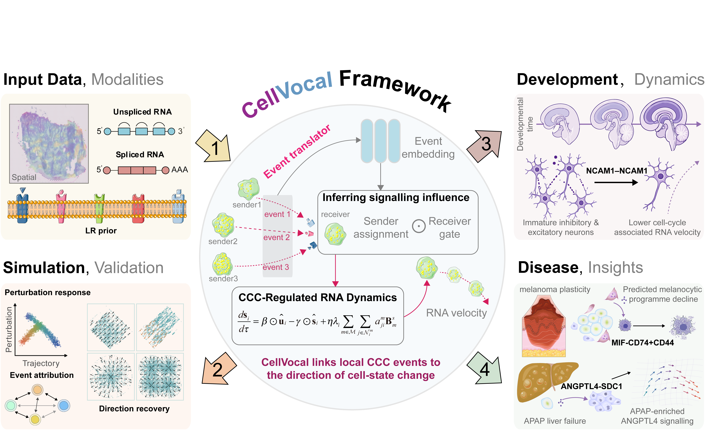

# CellVOCAL

CellVOCAL estimates RNA velocity and inferred signalling influence for candidate
cell–cell communication (CCC) events from spatial transcriptomics data with spliced and unspliced RNA
measurements.



## Method

The model combines an RNA kinetic encoder, a spatial neighbor graph, and
ligand–receptor (LR) candidates. It estimates intrinsic and CCC-associated
velocity components, latent time, module activation probabilities, conditional
sender shares, and nonnegative event influences. These estimates describe
transcriptional modulation in receiver cells. Downstream screens nominate
candidate regulatory signals for further investigation. An optional local,
LLM-free event translator can refine event representations in `off`, `load`, or `train` mode.


## Documentation

| Document | Scope |
| --- | --- |
| [PIPELINE.md](PIPELINE.md) | Canonical workflow: input fields, configuration, training, output contract, and analysis hand-off. |
| [MODEL_CARD.md](MODEL_CARD.md) | Intended use, scientific interpretation, evaluation context, limitations, and research-use considerations. |
| README.md | Project overview, installation, navigation, repository layout, and license. |

Dataset-specific provenance, input preparation, and available outputs are
documented in `paper/data/<dataset>/README.md`. Simulation generators and
manuscript reference notebooks are in `paper/`; the reusable model API is in
`pipeline/`.

## Installation

```bash
conda env create -f environment.yml
conda activate cellvocal
```

Run commands from the project root. The Conda environment covers the
CellVOCAL pipeline, simulation generators, notebooks, and plotting tools.

## Start an analysis

For a complete external-data tutorial, open
[example/example.ipynb](example/example.ipynb). It uses public human-kidney
Slide-seq spliced/unspliced counts and measured spatial coordinates, with
source verification, QC, a dataset-specific fit, model reload and the existing
velocity/communication tools in `utils`. Download and configuration steps are
included in the notebook; training is commented out by default.

Prepare one `AnnData` object with `layers["unspliced"]`,
`layers["spliced"]`, `obsm["spatial"]`, and gene names compatible with an LR
prior. Then follow [PIPELINE.md](PIPELINE.md) for configuration, the
`pipeline.cellvocal.run_cellvocal` call, saved files, and downstream analysis.

The reference notebooks in [paper/notebook/](paper/notebook/) document
manuscript datasets and simulations. Training cells are commented out by
default. Consult each dataset README for the inputs and saved CellVOCAL
outputs available under `paper/data/<dataset>/`. For an end-to-end workflow,
use the external-data example or the reusable API described above.

The `human_liver`, `mouse_embryo`, and `mouse_melanoma` notebooks reference
LR-screening tables that are not bundled. To inspect their saved results,
follow the notebook notes to skip the LR-table initialization lines. Refitting
requires supplying or rebuilding those tables, or configuring an alternative
LR prior.

## Project structure

| Path | Description |
| --- | --- |
| `model/` | CellVOCAL network, graph construction, configuration, and training code |
| `pipeline/` | Reusable training and analysis APIs |
| `example/` | Standalone public human-kidney tutorial and data provenance |
| `paper/data/` | Dataset READMEs, `raw/` inputs, and `cellvocal/` outputs |
| `paper/simulation/` | Direction, event-attribution, and differential data generators |
| `paper/notebook/` | Manuscript dataset and simulation reference notebooks |
| `utils/` | Metrics, plotting, and supporting tools |
| `resource/cellchatdb/` | Bundled human and mouse CellChatDB resources |

## License

GNU General Public License v3.0. See [LICENSE](LICENSE).
